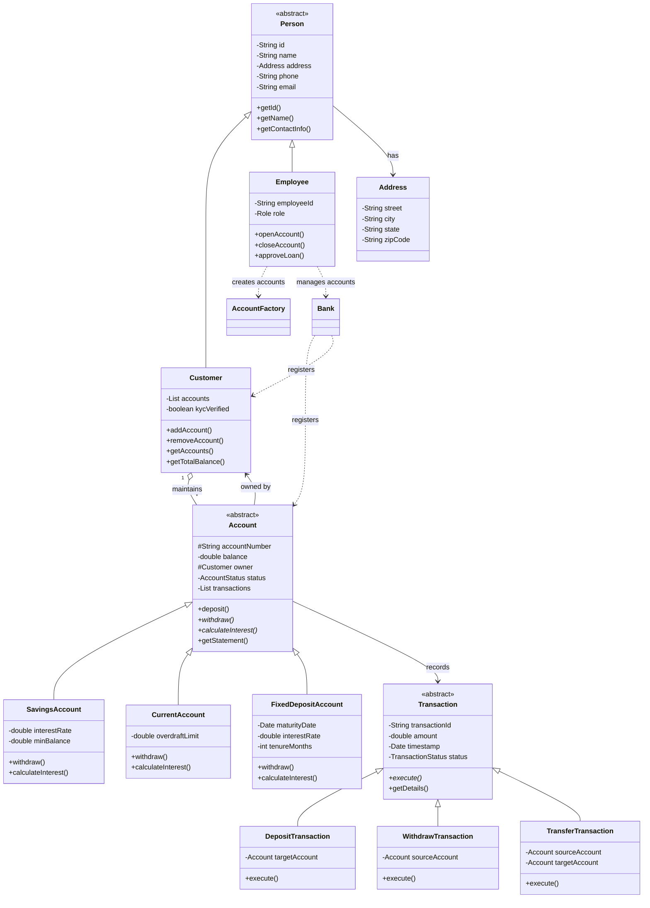
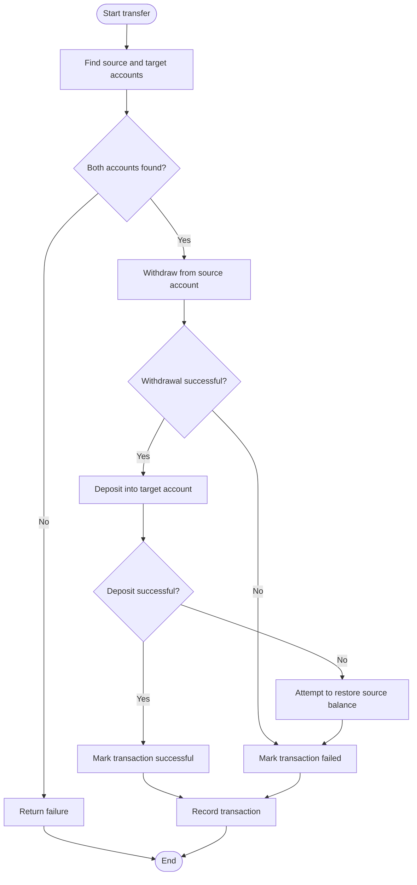

# 🏦 Banking Management System

### A Java OOP & Low-Level Design Project

<p align="center">
  A Java banking simulation demonstrating object-oriented programming, account management, transaction processing, and software design patterns.
</p>

<p align="center">
  
  
  
  
</p>

---

## 📌 About the Project

The **Banking Management System** is a Java project created to practice Object-Oriented Programming (OOP) and Low-Level Design (LLD) through a banking-domain example.

It models customers, employees, bank accounts, and financial transactions. The current implementation includes savings, current, and fixed-deposit accounts, along with account registration, account closure, deposits, withdrawals, transfers, and transaction history structures.

The primary goal is to learn how to design maintainable classes, represent relationships between objects, and apply common design patterns. This is an educational simulation, not production banking software.

## ✨ Features

### 👤 Customer Management
- Store customer details and contact information.
- Associate multiple accounts with a customer.
- Calculate the combined balance across a customer's accounts.
- Store a KYC verification flag.

### 💳 Account Types
- **Savings Account:** Withdrawal rules include a configured minimum balance; supports interest calculation.
- **Current Account:** Supports withdrawals within a configured overdraft limit.
- **Fixed Deposit Account:** Stores maturity date and tenure and calculates estimated interest.

### 💸 Transactions
- Deposit money into an account.
- Withdraw money according to account-specific rules.
- Transfer money between two accounts.
- Track transaction amount, timestamp, and status (`PENDING`, `SUCCESS`, or `FAILED`).
- Store transaction records in an account's statement list.

### 🏦 Bank Operations
- Register customers and accounts.
- Find accounts using account numbers.
- Close eligible accounts with a zero balance.
- Maintain in-memory customer and account registries.

### 🧩 Design
- Encapsulation, abstraction, inheritance, and polymorphism.
- Factory Pattern for creating account types.
- Singleton Pattern for a shared `Bank` instance.

## 🛠️ Tech Stack

| Technology | Purpose |
|---|---|
| Java | Core programming language |
| Java Collections Framework | Store customers, accounts, and transactions |
| `Date` API | Represent creation dates and transaction timestamps |
| `UUID` | Generate account and transaction identifiers |
| OOP and design patterns | Organize domain logic and object creation |

**Prerequisites:** Install a compatible JDK and use a Java IDE such as IntelliJ IDEA, Eclipse, or VS Code.

---

## 🏗️ System Architecture

### Class Relationship Diagram



### Main Components

- **`Person`:** Abstract base class for common personal details.
- **`Customer`:** Stores customer-specific data and manages associated accounts.
- **`Employee`:** Represents bank staff and exposes account-opening and account-closing operations.
- **`Account`:** Defines shared account behavior and abstract methods for withdrawals and interest calculations.
- **Concrete accounts:** Implement account-specific withdrawal rules and interest calculations.
- **`Transaction`:** Defines common transaction data and execution behavior.
- **Concrete transactions:** Implement deposits, withdrawals, and transfers.
- **`AccountFactory`:** Creates an account based on the requested `AccountType`.
- **`Bank`:** Holds in-memory registries and provides registration, lookup, closure, and transfer operations.

## 🔄 Transfer Workflow



*This diagram describes the current high-level logic. The implementation attempts to restore the source balance if the destination deposit fails, but it does not provide database-level atomicity or guaranteed rollback.*

---

## 🎯 OOP Concepts Demonstrated

| Concept | Example in the project | Purpose |
|---|---|---|
| **Encapsulation** | Private fields in `Person`, `Customer`, `Account`, and `Transaction` | Restricts direct access to internal state. |
| **Abstraction** | Abstract `Person`, `Account`, and `Transaction` classes | Defines common structure and behavior. |
| **Inheritance** | `Customer` and `Employee` extend `Person`; account types extend `Account` | Reuses common fields and behavior. |
| **Polymorphism** | Overridden `withdraw()`, `calculateInterest()`, and `execute()` methods | Allows behavior to vary by concrete type. |
| **Association** | Accounts reference their owner; customers maintain account lists | Models relationships between domain objects. |

## 🧠 Design Patterns

### 1. Singleton Pattern — `Bank`

The `Bank` class has a private constructor and a static `getInstance()` method. This provides one shared bank object for the application's in-memory customer and account registries.

> **Current limitation:** The `getInstance()` implementation is not thread-safe.

### 2. Factory Pattern — `AccountFactory`

The factory centralizes account creation and returns the appropriate subtype based on `AccountType`.

```java
Account account = AccountFactory.createAccount(
        customer,
        AccountType.SAVINGS
);
```

The returned reference has type `Account`, while the created object may be a `SavingsAccount`, `CurrentAccount`, or `FixedDepositAccount`.

---

## 📂 Project Structure

The code provided for the current version places the classes in a single Java source file. The following is a **suggested future structure** if the project is split into separate files:

```text
Banking-System/
├── src/
│   └── Banking_System/
│       ├── BankSystem.java
│       ├── Bank.java
│       ├── AccountFactory.java
│       ├── Address.java
│       ├── Person.java
│       ├── Customer.java
│       ├── Employee.java
│       ├── Account.java
│       ├── SavingsAccount.java
│       ├── CurrentAccount.java
│       ├── FixedDepositAccount.java
│       ├── Transaction.java
│       ├── DepositTransaction.java
│       ├── WithdrawTransaction.java
│       ├── TransferTransaction.java
│       └── enums/
│           ├── AccountStatus.java
│           ├── AccountType.java
│           ├── TransactionStatus.java
│           └── Role.java
├── README.md
└── .gitignore
```

---

## 🚀 Getting Started

### 1. Check Java is installed

```bash
java -version
javac -version
```

### 2. Clone the repository

```bash
git clone <your-repository-url>
cd Banking-System
```

Replace `<your-repository-url>` with your actual GitHub repository URL.

### 3. Compile the source

If all classes are in `BankSystem.java`, the file is stored under a `Banking_System` directory, and the package declaration is `package Banking_System;`, compile from the directory containing that folder:

```bash
javac Banking_System/BankSystem.java
```

### 4. Run the application

The supplied `BankSystem` class currently has an empty entry-point method written as `static void main()`. For conventional compatibility, use the standard Java entry point:

```java
public static void main(String[] args) {
    // Initialize and run the application here.
}
```

After implementing the application entry point, run:

```bash
java Banking_System.BankSystem
```

Adjust the commands if your package or source-file layout differs.

---

## 🧪 Example: Create a Customer and Savings Account

This example illustrates how the current domain classes can be used:

```java
Address address = new Address(
        "Main Street",
        "Patna",
        "Bihar",
        "800001"
);

Customer customer = new Customer(
        "CUST-101",
        "Rahul Kumar",
        address,
        "9876543210",
        "rahul@example.com",
        true
);

Bank bank = Bank.getInstance();
bank.registerCustomer(customer);

Account account = AccountFactory.createAccount(
        customer,
        AccountType.SAVINGS
);

if (bank.registerAccount(account)) {
    customer.addAccount(account);
    System.out.println("Account created successfully.");
}
```

**Important:** The factory currently sets the savings account's opening balance to `0.0`, while `SavingsAccount` requires the balance to remain at least `1000.0` after a withdrawal. The opening-balance and minimum-balance rules should be aligned before treating the workflow as complete.

---

## 🧪 Testing

Automated unit tests have not yet been included in the supplied implementation. Recommended test cases include:

- Successful and invalid deposits.
- Savings-account withdrawals that respect the minimum balance.
- Current-account withdrawals at and beyond the overdraft limit.
- Fixed-deposit withdrawals before and after maturity.
- Transfers with valid and invalid account numbers.
- Account closure with zero and non-zero balances.
- Transaction status and statement-history updates.
- Interest calculations for all account types.

---

## ⚠️ Current Limitations & Roadmap

The project is a learning-oriented simulation and is **not production-ready**.

- [ ] Implement an interactive console menu and complete `main()` workflow.
- [ ] Validate amounts, account numbers, ownership, and account status.
- [ ] Enforce KYC and employee authorization where appropriate.
- [ ] Reject transactions on closed or frozen accounts.
- [ ] Ensure deposit and withdrawal operations consistently create transaction records.
- [ ] Improve transfer atomicity and rollback handling.
- [ ] Prevent fixed-deposit withdrawals before maturity without relying on an unchecked runtime exception.
- [ ] Align opening-balance policies with minimum-balance rules.
- [ ] Add unit tests and custom exception handling.
- [ ] Use `BigDecimal` instead of `double` for monetary values.
- [ ] Split classes into packages and introduce Maven or Gradle.
- [ ] Add persistence using a database and a repository layer.
- [ ] Consider thread safety for shared bank state.
- [ ] Extend the model with loan processing, authentication, and role-based access control.

### Implementation Notes

- `getStatement()` returns a copy of the transaction list, but the transaction objects inside it are still mutable.
- Fixed-deposit maturity currently approximates each month as 30 days.
- `closeAccount()` changes the account status but leaves the account in the bank registry.
- The transfer implementation attempts to restore the source balance if the target deposit fails; this is not equivalent to a guaranteed atomic transaction.
- Account status is stored, but the current deposit and withdrawal methods do not consistently enforce it.

## 🔮 Future Scope

Potential extensions include:

- A database-backed persistence layer.
- REST APIs using Spring Boot.
- A web frontend using React.
- Authentication and role-based access control.
- Loan application and approval workflows.
- Transaction audit logs and reporting.
- Notifications for successful and failed transactions.
- Automated testing and continuous integration.

## 👨‍💻 Author

**Abhishek Kumar**  
B.Tech Computer Science Student | Java | OOP | Low-Level Design

## 📜 Disclaimer

This project is intended for educational purposes only. It must not be used to handle real customer information, real money, or production banking operations.

<p align="center">
  <strong>Learn by building. Improve by iterating. Code with purpose. 🚀</strong>
</p>
